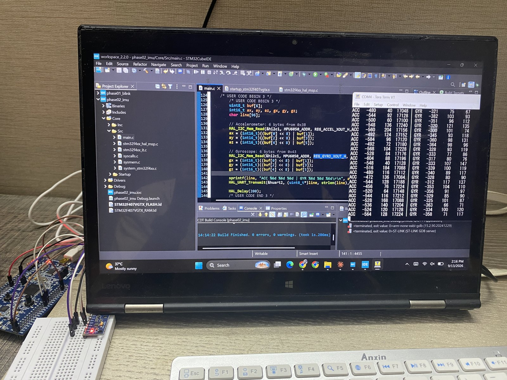
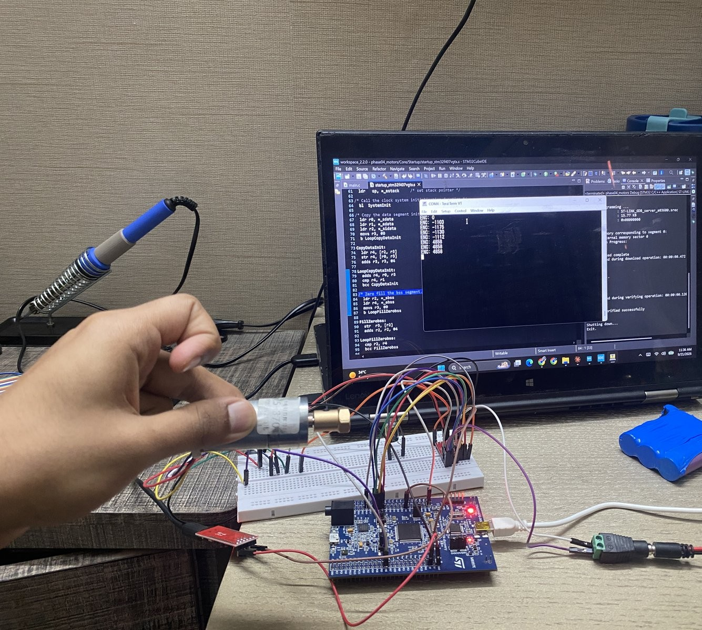
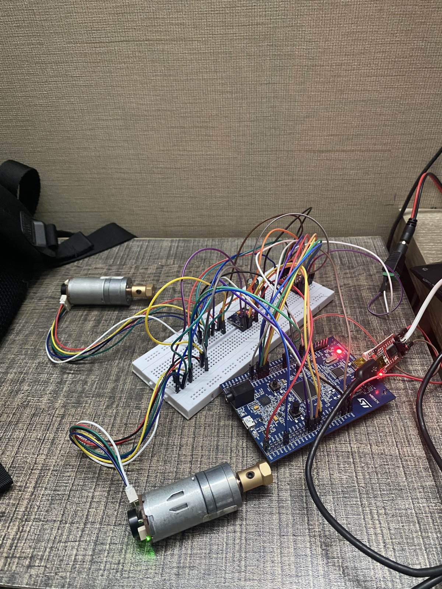

# Self-Balancing Robot (STM32F407): in development

Development of a two-wheeled self-balancing robot on an STM32F407 Discovery board.

**Current state:** IMU acquisition, tilt estimation (complementary and Kalman filters) and
open-loop motor and encoder bring-up are done and documented with logged data. The Phase 5
firmware runs the tilt filter on a 200 Hz timer tick. The robot is not yet assembled and no
controller is running.

**Plan:** PID balance, then an LQR controller designed from a measured model of the robot,
compared with cascade PID under one written test protocol.

---

## Status

| Phase | Goal | State |
|-------|------|-------|
| 1 | Toolchain + blink (prove the flash/debug path) | ✅ done |
| 2 | Read the IMU (I2C → MPU6500, raw data over UART) | ✅ done |
| 3 | Tilt estimation (complementary filter → Kalman), logged + plotted | ✅ done |
| 4 | Drive a motor (PWM + TB6612, read its encoder), open-loop verify; motor A only | ✅ done; interval-logged re-run pending |
| 5 | Second motor + close the loop: PID on a fixed-rate timer tick; first balance | 🟡 in progress: both motors and encoders wired (signs not yet verified); IMU driver and tilt filter on the 200 Hz tick, measured at 199.89 Hz against the PC clock with 0 missed ticks; PID not written; robot not assembled |
| 6 | Add outer velocity loop + LQR; **PID vs LQR comparison** | ⬜ not started |
| 7 | Document: report, plots, wiring diagram, demo GIF | ⬜ not started |

---

## Firmware

Each folder is a complete STM32CubeIDE project (STM32CubeMX 6.18.1, STM32Cube FW_F4 V1.28.3).

| Folder | Phase(s) | What the committed code does |
|--------|----------|------------------------------|
| [`firmware/phase01_blink`](firmware/phase01_blink) | 1 | Holding the user button (PA0) lights the on-board LEDs. The first step of this phase, a 1 Hz blink, was replaced by this code. |
| [`firmware/phase02_imu`](firmware/phase02_imu) | 2 + 3 | Reads the IMU over I2C, runs a complementary filter and a 2-state Kalman filter, and streams `time, accel, gyro-only, complementary, kalman` as CSV over UART. Phase 3 was built inside the Phase 2 project. |
| [`firmware/phase04_motors`](firmware/phase04_motors) | 4 | 25 kHz PWM into a TB6612FNG, TIM3 hardware quadrature decoding. Forward/reverse test at 30 % duty printing `time_ms,dir,cmd,count,delta` about every 200 ms (the September version printed only the running count). |
| [`firmware/phase05_balance`](firmware/phase05_balance) | 5 (in progress) | 168 MHz clock, 21 kHz PWM on both motors, TIM2/TIM3 encoders, TIM6 200 Hz tick. `mpu6500.c` sets the sensor's ranges and low-pass filters and reads all six axes in one burst; `tilt.c` calibrates the gyro bias (failing if too few reads succeed) and runs a complementary filter with a 0.75 s time constant. The tick interrupt only counts; `main.c` processes pending ticks, counts missed ones, streams `time, angle, rate` at about 10 Hz and timing statistics once per second. Motors stay stopped; IMU failures and fault handlers put the motor driver in standby. |

## Hardware

Core: **STM32F407G-DISC1** (on-board ST-Link/V2 — no external programmer needed). The IMU
module was sold as an MPU6050; the chip reports the MPU6500's ID (`WHO_AM_I = 0x70`).
Full bill of materials and open items: [`docs/hardware-inventory.md`](docs/hardware-inventory.md).

## Toolchain

- **STM32CubeIDE 2.2.0 / STM32CubeMX 6.18.1** — firmware, HAL config, build, flash, SWD debug
- **Python** (numpy, matplotlib) — logging and plots; **python-control** planned for the Phase 6 LQR design
- **Overleaf / LaTeX** — planned for the final report

## Repo layout

```
docs/             phase records (what was built, measured and found), hardware inventory
docs/guides/      step-by-step build guides followed in each phase
firmware/         STM32CubeIDE projects (see the table above)
control/          logged runs, plots, analysis scripts (index: control/README.md)
media/            bench photos
LEARNING_LOG.md   dated log of what was done, learned and debugged, with corrections marked
```

## Results so far

**Phase 3: tilt estimation** ([record](docs/phase-03-record.md)). A complementary filter and a
2-state Kalman filter run side by side on the same IMU samples, logged with the accel-only and
gyro-only angles at 63-67 Hz (15-16 ms loop) during hand tilts of about +/-60 deg. The gyro-only angle
drifts, the accel angle is noisy, and the fused estimates follow the accel angle without the noise.
There is no independent angle reference, so this shows filter behaviour, not accuracy. An offline
replay of the logged inputs showed that both Kalman runs were recorded with `R_measure = 0.03`,
including the one saved as "R = 0.1"; run on identical inputs, R = 0.03 and R = 0.1 differ by a
median of 0.2-0.3 deg and mainly during large excursions.

**Phase 4: open-loop drive** ([record](docs/phase-04-record.md)). Motor A at 30 % duty, 25 kHz PWM:
the encoder count changed by about +245 per 200 ms forward and about -244 in reverse (about 1225
counts/s), with the direction of the count matching the command. These figures were read off the
terminal; the raw output was not saved. A re-run with per-interval logging is pending.

**Phase 5: in progress** ([record](docs/phase-05-record.md)). The 200 Hz loop measured against the PC clock over 64 s:
199.89 Hz, 0 missed ticks, longest pass 2.4 ms of the 5 ms tick with telemetry on. The
motor sign convention (`MOTOR_A_SIGN = +1`, `MOTOR_B_SIGN = -1`) is not yet verified: an encoder
count shows the product of a motor's drive and encoder polarities, so the drive signs will be set by
watching the wheels on the assembled chassis.

_(Step-response and disturbance-rejection plots, settling time, overshoot, control-loop rate and
the demo GIF land here as Phases 5–7 complete.)_

## Bench photos

| Phase 2 — raw IMU stream | Phase 4 — motor A encoder test | Phase 5 — two-motor wiring |
|---|---|---|
|  |  |  |
