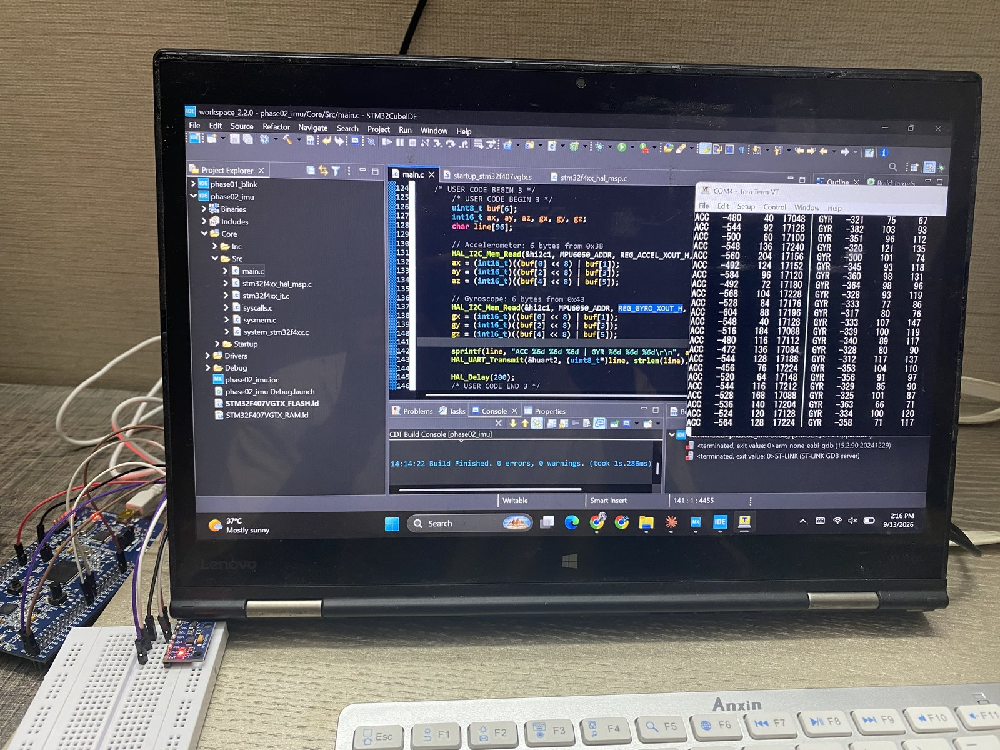
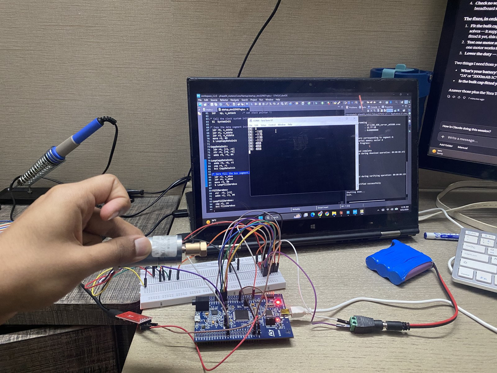
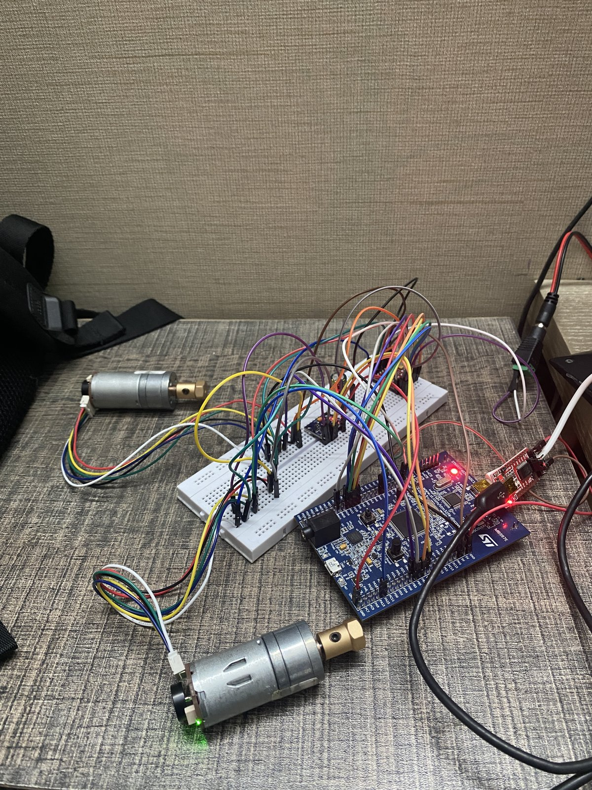

# Self-Balancing Robot — STM32F407

A two-wheeled self-balancing robot built on an STM32F407 as a hands-on study of
**real-time embedded control**. Balancing is the baseline, not the goal. The goal is a
**quantitative comparison of a PID controller against an LQR controller** on the same physical
plant, with measured step-response and disturbance-rejection plots.

> Built as a portfolio project for a Master's application (embedded / control systems / robotics).
> Work in progress — the status table below is kept current.

---

## Status

| Phase | Goal | State |
|-------|------|-------|
| 1 | Toolchain + blink (prove the flash/debug path) | ✅ done |
| 2 | Read the IMU (I2C → MPU6500, raw data over UART) | ✅ done |
| 3 | Tilt estimation (complementary filter → Kalman), logged + plotted | ✅ done |
| 4 | Drive motors (PWM + TB6612, read encoders), open-loop verify | ✅ done |
| 5 | Second motor + close the loop: PID on a fixed-rate timer ISR; first balance | 🟡 in progress — peripherals configured, both motors and encoders running with a verified sign convention; IMU, tilt and PID modules not yet written |
| 6 | Add outer velocity loop + LQR; **PID vs LQR comparison** | ⬜ not started |
| 7 | Document: report, plots, wiring diagram, demo GIF | ⬜ not started |

---

## Firmware

Each folder is a complete STM32CubeIDE project (STM32CubeMX 6.18.1, STM32Cube FW_F4 V1.28.3).

| Folder | Phase(s) | What the committed code does |
|--------|----------|------------------------------|
| [`firmware/phase01_blink`](firmware/phase01_blink) | 1 | Holding the user button (PA0) lights the on-board LEDs. The first step of this phase, a 1 Hz blink, was replaced by this code. |
| [`firmware/phase02_imu`](firmware/phase02_imu) | 2 + 3 | Reads the IMU over I2C, runs a complementary filter and a 2-state Kalman filter, and streams `time, accel, gyro-only, complementary, kalman` as CSV over UART. Phase 3 was built inside the Phase 2 project. |
| [`firmware/phase04_motors`](firmware/phase04_motors) | 4 | 25 kHz PWM into a TB6612FNG, TIM3 hardware quadrature decoding, forward/reverse test printing the encoder count every 200 ms. |
| [`firmware/phase05_balance`](firmware/phase05_balance) | 5 (in progress) | 168 MHz clock, 21 kHz PWM on both motors, TIM2/TIM3 encoders, TIM6 configured for a 200 Hz control tick (not yet started). `motors.c` holds the single motor-drive helper and the mirror sign convention. `main.c` is currently a two-motor encoder test. |

## Hardware

Core: **STM32F407G-DISC1** (on-board ST-Link/V2 — no external programmer needed). The IMU
module was sold as an MPU6050; the chip reports the MPU6500's ID (`WHO_AM_I = 0x70`).
Full bill of materials and open items: [`docs/hardware-inventory.md`](docs/hardware-inventory.md).

## Toolchain

- **STM32CubeIDE 2.2.0 / STM32CubeMX 6.18.1** — firmware, HAL config, build, flash, SWD debug
- **Python** (numpy, matplotlib) — logging and plots; **python-control** planned for the Phase 6 LQR design
- **Overleaf / LaTeX** — planned for the final report

## Repo layout

```
docs/        phase build guides, hardware inventory
firmware/    STM32CubeIDE projects (see the table above)
control/     logged CSV runs, plots, plotting script
media/       bench photos
LEARNING_LOG.md   dated log of what was done, learned and debugged, with corrections marked
```

## Results so far

**Phase 3 — tilt estimation.** The board runs a complementary filter (`alpha = 0.98`) and a
2-state Kalman filter (angle + gyro bias) side by side on the same live IMU samples and streams
both, with the accel-only and gyro-only angles for comparison. In the logged runs (tilt sweeps
of about ±60°) the gyro-only angle visibly drifts, the accel-only angle is noisy, and the fused
estimates follow the tilt. The logged loop runs at ~62–67 Hz (15–16 ms period: a 10 ms delay
plus the blocking I2C reads and UART print). Two runs were made with `R_measure = 0.03` and `0.1`; they used different
disturbances, so they do not yet isolate the effect of R — see the Phase 3 entry in the
[learning log](LEARNING_LOG.md). Runs and plots: [`control/`](control).

**Phase 4 — open-loop drive.** Motor A under 25 kHz PWM + TB6612 with TIM3 hardware encoder
feedback: **+245 counts / 200 ms forward, −244 counts / 200 ms reverse** (≈1225 counts/s at 30 %
duty), steady across samples and symmetric in both directions, with measured direction matching
the commanded one.

**Phase 5 — in progress.** Both motors driven through one helper with a software sign
convention (`MOTOR_A_SIGN = +1`, `MOTOR_B_SIGN = −1`); with that convention both encoders count
positive when the robot is commanded forward.

_(Step-response and disturbance-rejection plots, settling time, overshoot, control-loop rate and
the demo GIF land here as Phases 5–7 complete.)_

## Bench photos

| Phase 2 — raw IMU stream | Phase 4 — motor A encoder test | Phase 5 — two-motor wiring |
|---|---|---|
|  |  |  |
